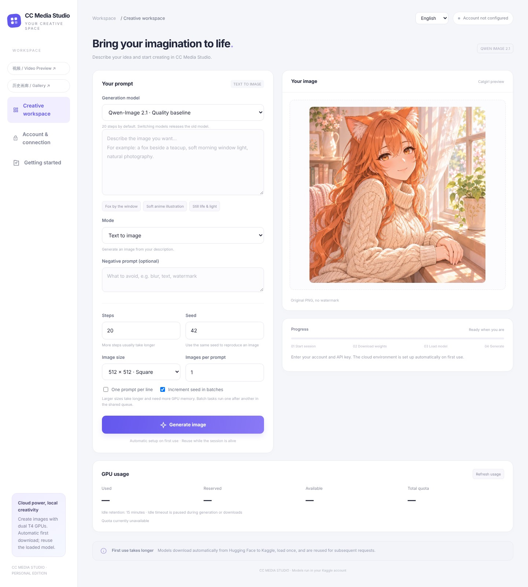

# CC Media Studio

[简体中文](README.md) | **English**

Generate images with your own Kaggle GPU quota. Start the launcher, enter your Kaggle username and API key, and create in a lightweight local interface. Model downloads, loading, and inference run in the cloud.



- Windows, macOS, and Linux launchers with automatic dependency installation.
- Three models, automatic downloads, private caches, and live model reuse.
- Chinese / English interface with download progress, GPU usage, and idle countdown.
- GUI, ComfyUI, standalone Kaggle notebook, local MCP, and HTTP API.

## Download and launch

Install **Python 3.11 or 3.12**, then [download the ZIP](https://github.com/cc6pzupa/free-media-studio/archive/refs/heads/main.zip) and extract it. This is a private repository; sign in with an authorized GitHub account to download.

| System | Launch |
| --- | --- |
| Windows | Double-click `start_windows.bat` |
| macOS | Run `bash start_mac.command` in the project folder |
| Linux | Run `bash start_linux.sh` in the project folder |

The launcher creates `.easy-venv` and installs dependencies. Keep its window running. The GUI opens at **http://127.0.0.1:8787**.

Or use Git:

```bash
git clone https://github.com/cc6pzupa/free-media-studio.git
cd free-media-studio
python launch.py
```

Use `python3 launch.py` on macOS/Linux. On Windows, select **Add python.exe to PATH** when installing Python.

## Generate your first image

1. Open **Account & connection**.
2. Enter your Kaggle profile **username** and **API key / API token**.
3. Select **Remember configuration** and **Save connection**.
4. Select a model, write a prompt, and click **Generate image**.
5. Select **Save image** to download the PNG.

Create tokens in [Kaggle API settings](https://www.kaggle.com/settings/api). Your account needs the verification required for GPU use and available quota. Automatic mode does not need a dataset or Jupyter URL.

First use prepares a dual T4 session, downloads weights, and saves a private cache. The progress card shows actual bytes and stages. Later requests reuse the loaded model; new sessions first check the cache. Switching models releases the previous model and retains downloaded files.

## Choose a model

| Model | Default steps | Use |
| --- | --- | --- |
| Qwen-Image 2.1 | 20, adjustable | General image generation |
| Z-Image Turbo | 9, adjustable | Efficiency |
| SDXL-Lightning | Fixed at 4 | Quick previews; English prompts recommended |

Selecting a model applies its recommended steps. Output is one **512×512 PNG**, with seed **42** by default. Completion status shows encoding, denoising, and decode time.

Each model has a separate private cache. Qwen's initial raw download is approximately 23.51 GB, with a prepared INT8/Q4 cache of about 16 GB. Other models show their actual download size in the progress card.

## GPU usage and idle retention

The GUI shows used, reserved, available, and total GPU quota plus reset time. It refreshes every minute and supports manual refresh.

Default idle retention is **15 minutes** after the final task finishes. Queued tasks, downloads, loading, and generation prevent idle release. Status and quota checks do not extend the timer.

Set **0–1440 minutes** in Account & connection; `0` disables automatic release. Or pass a startup option:

```bash
python launch.py --keep-alive-minutes 30
```

Closing the GUI leaves the local worker running. Automatic release needs the computer online and the worker running. Manual Jupyter sessions and direct Kaggle notebooks are managed by the user.

## ComfyUI

From ComfyUI's parent directory:

```bash
git clone https://github.com/cc6pzupa/free-media-studio.git ComfyUI/custom_nodes/cc-media-studio
<ComfyUI-Python> -m pip install -r ComfyUI/custom_nodes/cc-media-studio/requirements.txt
```

Restart ComfyUI, add **CC Media Image**, and connect `IMAGE` to **Save Image** → `images`.

Save account configuration once in the GUI under the same system user. The GUI can then be closed. Select `model_id`; with `use_model_defaults` enabled, Z-Image uses 9 steps and SDXL-Lightning uses 4.

## Kaggle notebook

Import [`kaggle_standalone.ipynb`](kaggle_standalone.ipynb), select **GPU T4 ×2**, enable **Internet**, and run all cells. Select a model and enter a prompt in the notebook interface.

Optional cache settings accept your Kaggle username and key for cross-session private caching. Leave them empty for generation within the current session.

## Local MCP

Install with the project environment:

```powershell
# Windows
.\.easy-venv\Scripts\python.exe -m pip install -r requirements-mcp.txt
```

```bash
# macOS / Linux
.easy-venv/bin/python -m pip install -r requirements-mcp.txt
```

Register `mcp_server.py` in an AI client supporting local stdio MCP. It uses credentials saved in the GUI.

| Tool | Purpose |
| --- | --- |
| `studio_status` | Models, configuration, queue, GPU usage |
| `generate_image` | Submit generation and return a job ID |
| `get_job` | Read progress |
| `get_image` | Retrieve the completed PNG |

See the [MCP setup guide](docs/mcp.en.md) for platform configurations and examples.

## HTTP API

Start the GUI and find the local API key in advanced settings.

```http
POST http://127.0.0.1:8787/v1/images/generations
Authorization: Bearer <local API key>
Content-Type: application/json

{"prompt":"An adult catgirl by a sunny window, anime illustration","model_id":"z-image-turbo","seed":42}
```

`data[0].b64_json` contains the PNG. `usage` includes model, steps, timings, cache status, and reuse. Omitted `steps` uses the model default.

```http
GET http://127.0.0.1:8787/v1/studio/usage
Authorization: Bearer <local API key>
```

## Update

Finish queued work, close GUI/MCP clients, and stop the local worker:

```powershell
# Windows
.\.easy-venv\Scripts\python.exe studio_worker.py --stop
```

```bash
# macOS / Linux
.easy-venv/bin/python studio_worker.py --stop
```

Run `git pull`, then restart the launcher. MCP users also update dependencies from `requirements-mcp.txt`.

## Common questions

- **Browser did not open?** Visit `http://127.0.0.1:8787` or use `python launch.py --browser`.
- **Port in use?** Use `python launch.py --port 8788`.
- **First generation takes longer?** Progress includes queuing, downloads, preparation, caching, and loading. Later requests prioritize reuse.
- **Asked to restart an old worker?** Follow the update steps and relaunch.
- **Where is configuration?** `~/.kaggle-qwen-client/settings.json`; jobs and images are under `studio/` in the same directory.
- **How do I end the GPU session?** Wait for automatic idle release or stop it in Kaggle's session manager. Stopping the local worker affects the local service only.
