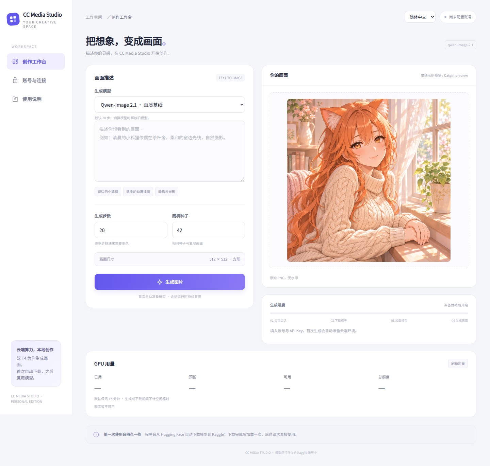

# CC Media Studio

**简体中文** | [English](README.en.md)

**源码可用 · 非商业使用免费 · 商业使用需另行授权** — [许可证](LICENSE) · [商业授权](COMMERCIAL.md)

本分支提供 [视频功能预览](docs/video.md)：三档模型、MP4 播放与下载，以及 GUI、MCP、ComfyUI 和 Kaggle Notebook 入口。

0.10.0 新增 [图片编辑、尺寸与批量预览](docs/editing.md)（[更新记录](CHANGELOG.md)）：图生图、涂抹局部编辑、图生视频、7 种尺寸、负面提示词，以及 GUI 批量生成与 ZIP 打包。

使用自己的 Kaggle GPU 额度生成图片。双击启动器，填写 Kaggle 用户名和 API Key，即可在本机界面创作；模型下载、加载和推理都在云端完成。



[中英双语图解教程](docs/guide.html)：下载仓库后，用浏览器打开 `docs/guide.html`。

- 支持 Windows、macOS、Linux，首次启动自动安装依赖。
- 三种模型可选，默认自动加速、双卡优先；自动准备权重并复用模型。
- 中文 / English 界面，显示下载进度、GPU 用量和空闲倒计时。
- 支持 GUI、ComfyUI、Kaggle Notebook、本地 MCP 和 HTTP API。

## 安装包与历史画廊

从 [Releases](https://github.com/cc6pzupa/free-media-studio/releases) 下载 Windows、macOS Intel / Apple Silicon 或 Linux deb/rpm 安装包，内含 Python 运行环境。图片与视频工作台提供历史画廊，支持搜索、收藏、预览和下载。[安装与画廊说明](docs/installers.md)

## 源码安装与启动

安装 **Python 3.11 或 3.12**，然后[下载 ZIP](https://github.com/cc6pzupa/free-media-studio/archive/refs/heads/main.zip) 并解压。源码已在 GitHub 公开，可直接下载 ZIP 或 clone 仓库。

| 系统 | 启动方式 |
| --- | --- |
| Windows | 双击 `start_windows.bat` |
| macOS | 在项目目录运行 `bash start_mac.command` |
| Linux | 在项目目录运行 `bash start_linux.sh` |

启动器会创建 `.easy-venv` 并安装依赖。保持启动窗口运行，GUI 默认地址为 **http://127.0.0.1:8787**。

也可以使用 Git：

```bash
git clone https://github.com/cc6pzupa/free-media-studio.git
cd free-media-studio
python launch.py
```

macOS / Linux 使用 `python3 launch.py`。Windows 安装 Python 时勾选 **Add python.exe to PATH**。

## 第一次生图

新注册的账号也可从零使用：完成 Kaggle 手机验证、确认有可用 GPU 额度，再创建 API Key。无需已有 Dataset、权重或 Jupyter 地址，程序自动准备。

1. 打开左侧 **账号与连接**。
2. 填写 Kaggle 个人主页中的**用户名**，以及自己的 **API Key / API Token**。
3. 保持 **自动加速 · 双卡优先** 和 **空闲保活 15 分钟**，勾选 **记住账号配置**，点击 **保存连接**。
4. 回到创作工作台，选择模型，输入画面描述，点击 **生成图片**。
5. 图片生成后，点击 **保存图片** 下载 PNG。

API Token 可在 [Kaggle API 设置](https://www.kaggle.com/settings/api) 中创建。账号需已完成 GPU 使用所需的验证，并有可用额度。自动连接模式无需填写 Dataset 或 Jupyter 地址。

首次生成会自动准备 Kaggle 双 T4 会话、下载权重并保存私有缓存；进度卡片显示下载字节和当前阶段。后续请求复用已加载的模型，新会话优先读取缓存。切换模型会释放旧模型，保留已下载文件。

## 选择模型

| 模型 | 默认步数 | 适用场景 | 热请求示例（双 T4） |
| --- | --- | --- | --- |
| Qwen-Image 2.1 | 20，可调整 | 通用文生图 | 约 49.7 秒 |
| Z-Image Turbo | 9，可调整 | 效率优先 | 约 8.2 秒 |
| SDXL-Lightning | 固定 4 | 快速预览，推荐英文提示词 | 约 1.5 秒 |

热请求示例为模型就绪后的云端耗时，首次下载、模型加载和客户端网络传输另计。

选择模型后自动应用推荐步数。默认输出 **512×512 PNG**，可在“画面尺寸”选择最大 1024 的 7 种尺寸；随机种子默认为 **42**。完成状态显示实际执行策略，以及编码、模型迁移、采样和解码耗时。

每个模型使用独立私有缓存。Qwen 首次原始权重下载约 23.51 GB，准备后的 INT8 / Q4 缓存约 16 GB；其他模型的实际下载量以进度显示为准。

## 双卡加速

默认 **自动加速 · 双卡优先**，GUI、ComfyUI、MCP、HTTP API 和 Kaggle Notebook 使用相同策略。

| 模型 | 双 T4 执行方式 |
| --- | --- |
| Qwen-Image 2.1 | 两张卡同时计算 CFG 正负分支；编码器与副本缓存复用 |
| Z-Image Turbo | GPU 1 编码，GPU 0 采样与解码 |
| SDXL-Lightning | 两个文本编码器在 GPU 1，GPU 0 采样与解码 |

Qwen 的同提示词、同种子输出与原模式一致。双卡副本首次准备需要额外时间，后续请求直接复用；加速不可用时自动恢复原分卡生成。生成结果会显示实际使用的策略。

在 **账号与连接 → 加速策略** 中可选择 **原分卡模式**，或设置启动参数：

```bash
python launch.py --acceleration split
```

`--acceleration auto` 恢复自动加速。Kaggle 独立 Notebook 提供相同选项；ComfyUI 和 MCP 读取已保存的配置。

## 单张生成与任务队列

HTTP 生图接口每次生成一张 PNG。MCP 可用不同的 `request_id` 连续提交多个任务，后台串行排队并复用模型；分别用返回的 `job_id` 查询进度和取图。

GUI 支持批量（预览）：每个提示词 1–8 张、每行一个提示词、种子递增，完成后打包下载 ZIP。历史画廊也可打包当前列表。

## 图片编辑（预览）

Z-Image Turbo 与 SDXL-Lightning 支持 **图生图**（参考图 + 重绘强度）和 **局部编辑**（在图片上涂抹，白色区域重绘）。LTX-Video 2B 与 Wan2.2 5B 支持 **图生视频**（上传首帧）。Qwen-Image 2.1 与 Wan 模型支持负面提示词。这些功能已在 Kaggle 双 T4 上实测通过，例如 Z-Image 图生图 512 约 6.6 秒、Wan2.2 图生视频 33 帧约 210 秒。详见 [图片编辑说明](docs/editing.md)。

## GPU 用量与保活

主界面显示 GPU 已用、预留、可用、总额度及重置时间，每分钟刷新，也可手动刷新。

默认**空闲保活 15 分钟**，从最后一个任务结束后计时。下载、加载、生图和排队时不触发空闲释放；查询状态和用量不延长计时。

在 **账号与连接** 中可设为 **0–1440 分钟**，`0` 表示关闭自动释放。也可通过启动参数设置：

```bash
python launch.py --keep-alive-minutes 30
```

关闭 GUI 后，本地后台继续处理任务和管理空闲会话。自动释放需要电脑保持联网、后台保持运行；手动 Jupyter 模式和直接运行的 Kaggle Notebook 由用户管理。

## ComfyUI

在 ComfyUI 的上级目录执行：

```bash
git clone https://github.com/cc6pzupa/free-media-studio.git ComfyUI/custom_nodes/cc-media-studio
<ComfyUI的Python> -m pip install -r ComfyUI/custom_nodes/cc-media-studio/requirements.txt
```

重启 ComfyUI，添加 **CC Media Image**，将 `IMAGE` 输出连接到 **Save Image** 的 `images`。

先在同一系统用户下通过 GUI 保存一次账号配置。节点可独立运行，GUI 无需保持打开。选择 `model_id`；启用 `use_model_defaults` 时，Z-Image 使用 9 步，SDXL-Lightning 使用 4 步。

## Kaggle Notebook

把 [`kaggle_standalone.ipynb`](kaggle_standalone.ipynb) 导入 Kaggle，选择 **GPU T4 ×2**、开启 **Internet**，运行全部单元格。在 Notebook 界面选择模型并输入提示词。

如需跨会话私有缓存，展开缓存设置填写自己的 Kaggle 用户名和 Key。只在当前会话生图时可留空。

## 本地 MCP

用项目环境中的 Python 安装：

```powershell
# Windows
.\.easy-venv\Scripts\python.exe -m pip install -r requirements-mcp.txt
```

```bash
# macOS / Linux
.easy-venv/bin/python -m pip install -r requirements-mcp.txt
```

在支持本地 stdio MCP 的 AI 客户端中注册 `mcp_server.py`。账号读取 GUI 已保存的配置。

| 工具 | 用途 |
| --- | --- |
| `studio_status` | 查看模型列表、账号配置、队列和 GPU 用量 |
| `generate_image` | 提交生图并返回任务编号 |
| `get_job` | 查询生成进度 |
| `get_image` | 取得完成后的 PNG |
| `cancel_job` | 取消尚未开始的任务 |

完整的三系统配置和调用步骤见 **[MCP 使用指南](docs/mcp.md)**。

## HTTP API

GUI 启动后，在高级设置中查看本机 API Key。

```http
POST http://127.0.0.1:8787/v1/images/generations
Authorization: Bearer <本机 API Key>
Content-Type: application/json

{"prompt":"An adult catgirl by a sunny window, anime illustration","model_id":"z-image-turbo","seed":42}
```

响应中的 `data[0].b64_json` 为 PNG；`usage` 包含模型、步数、耗时、缓存状态和复用信息。省略 `steps` 时使用所选模型默认值。

```http
GET http://127.0.0.1:8787/v1/studio/usage
Authorization: Bearer <本机 API Key>
```

## 许可证与商业授权

本项目原创代码与文档采用 **PolyForm Noncommercial 1.0.0**。许可范围内的非商业使用免费，允许修改和分发；分发时须保留许可证和 [NOTICE](NOTICE)。超出许可范围的商业使用需事先取得书面授权，申请方式见 [商业授权说明](COMMERCIAL.md)。具体允许用途以 [LICENSE](LICENSE) 为准。

第三方依赖、模型权重及另行许可的材料遵循各自许可证。

## 更新

等当前队列完成，关闭 GUI / MCP 客户端，再停止本地后台：

```powershell
# Windows
.\.easy-venv\Scripts\python.exe studio_worker.py --stop
```

```bash
# macOS / Linux
.easy-venv/bin/python studio_worker.py --stop
```

执行 `git pull` 后重新运行启动器。MCP 使用者同时更新 `requirements-mcp.txt` 中的依赖。

## 常见问题

- **浏览器没有自动打开？** 手动打开 `http://127.0.0.1:8787`，或使用 `python launch.py --browser`。
- **端口被占用？** 使用 `python launch.py --port 8788`。
- **第一次生成较久？** 进度包含会话排队、下载、准备、缓存和加载；后续优先复用。
- **提示重启旧后台？** 按更新步骤停止后台，再重新启动客户端。
- **配置保存在哪里？** 当前用户目录的 `.kaggle-qwen-client/settings.json`；任务和图片在同目录的 `studio/`。
- **如何结束 GPU 会话？** 等待空闲自动释放，或在 Kaggle 会话管理中停止。停止本地后台只影响本机服务。
