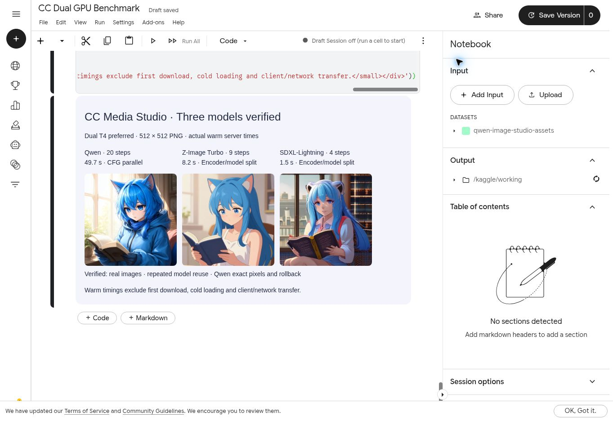

# 模型选择与性能 / Models and performance

所有入口默认使用 `auto`（双卡优先）。可在 GUI 的“账号与连接”中调整加速策略；命令行使用 `python launch.py --acceleration auto` 或 `--acceleration split`。

## 三个模型怎么选

| 模型 | 默认步数 | 适用场景 | 双 T4 热请求示例 |
| --- | --- | --- | --- |
| Qwen-Image 2.1 | 20，可调整 | 通用文生图 | 约 49.7 秒 |
| Z-Image Turbo | 9，可调整 | 效率优先 | 约 8.2 秒 |
| SDXL-Lightning | 固定 4 | 快速预览，推荐英文提示词 | 约 1.5 秒 |

以上为 512×512、模型已就绪时的云端请求示例，包含编码、设备迁移、采样、解码及 PNG 保存；首次下载、模型加载和客户端网络传输另计。各模型使用表中的默认步数，时间会随提示词、参数和运行环境变化。

## 双卡如何工作

| 模型 | 自动策略 |
| --- | --- |
| Qwen-Image 2.1 | 两张 T4 同时计算 CFG 正负分支，并复用加速副本 |
| Z-Image Turbo | GPU 1 编码，GPU 0 采样和解码 |
| SDXL-Lightning | GPU 1 运行两个文本编码器，GPU 0 采样和解码 |

Qwen 首次准备加速副本需要额外时间，后续请求直接复用。选择 `split` 时使用编码与生成分卡的方式。生成完成后，界面显示实际执行策略与分段耗时。

## 首次生成与连续生成

首次使用需要准备 Kaggle 会话、下载权重、建立缓存并加载模型。进度卡片显示当前阶段和下载字节。

同一活跃会话中，连续使用相同模型会复用已加载的实例；客户端重新连接也可继续使用。切换模型会释放当前模型，保留已下载的文件。新会话优先读取所选模型的私有缓存。

## 查看耗时

| 界面或 API 字段 | 含义 |
| --- | --- |
| `request_seconds` | 客户端完成本次请求的总耗时 |
| `encoding_seconds` | 提示词编码耗时 |
| `migration_seconds` | 模型设备迁移与准备耗时 |
| `replica_load_seconds` | Qwen 首次准备副本的耗时；复用时为 0 |
| `denoising_seconds` / `decode_seconds` | 采样与解码耗时 |
| `parallel_strategy` | 实际策略：`cfg_parallel` 或 `encoder_split` |

不同字段使用的计时范围不同，分段耗时不一定严格相加等于请求总耗时。

## English

Choose Qwen-Image 2.1 for general image generation, Z-Image Turbo for efficiency, or SDXL-Lightning for quick previews. Defaults are 20, 9 and exactly 4 steps. Example warm dual-T4 cloud requests at 512×512 take approximately 49.7, 8.2 and 1.5 seconds respectively, including encoding, transfers, generation and PNG saving. Initial downloads, model loading and client network transfers are additional.

Automatic acceleration is the default. Qwen computes positive and negative CFG branches concurrently on two GPUs; Z-Image and SDXL split text encoding from sampling and decoding. Repeated requests reuse the active model, while switching models retains downloaded files. The GUI and API report the actual strategy and timings.

## 模型资料 / Model references

- [Qwen-Image 2.1 Diffusers 文档](https://huggingface.co/docs/diffusers/main/api/pipelines/qwenimage21)
- [Z-Image Turbo](https://huggingface.co/Tongyi-MAI/Z-Image-Turbo)
- [SDXL-Lightning](https://huggingface.co/ByteDance/SDXL-Lightning)
